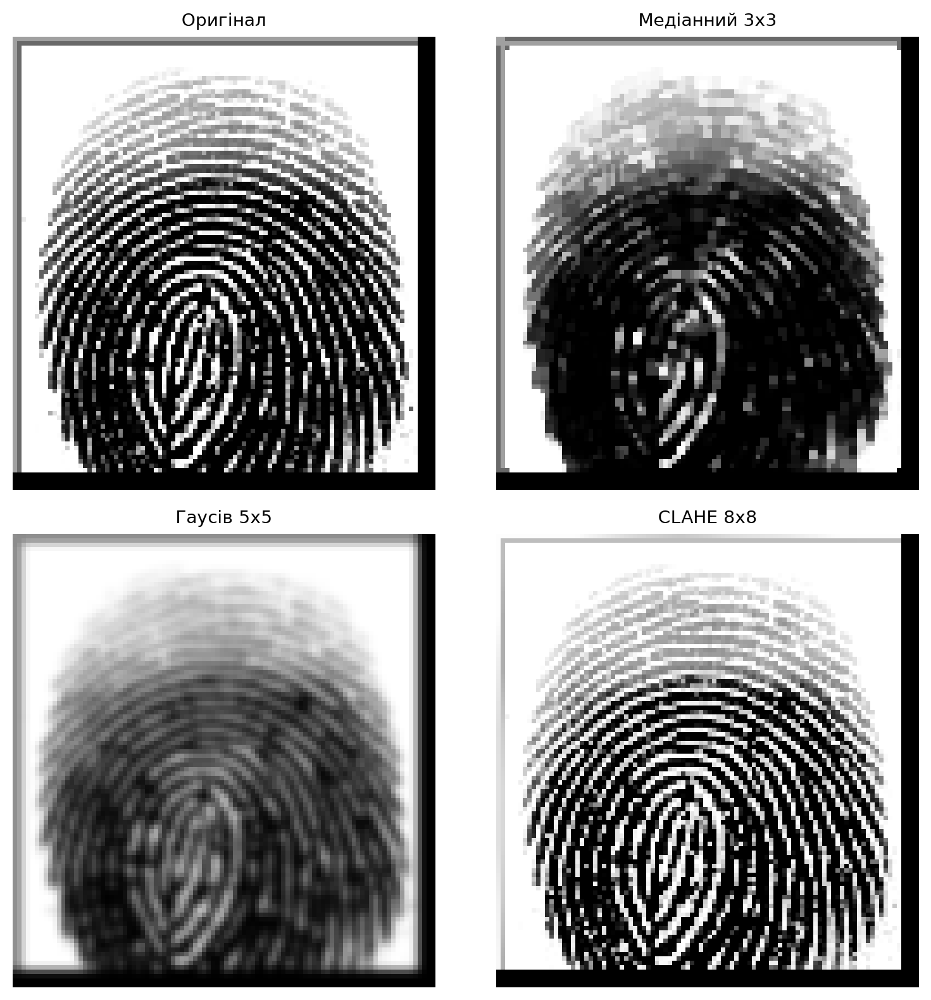
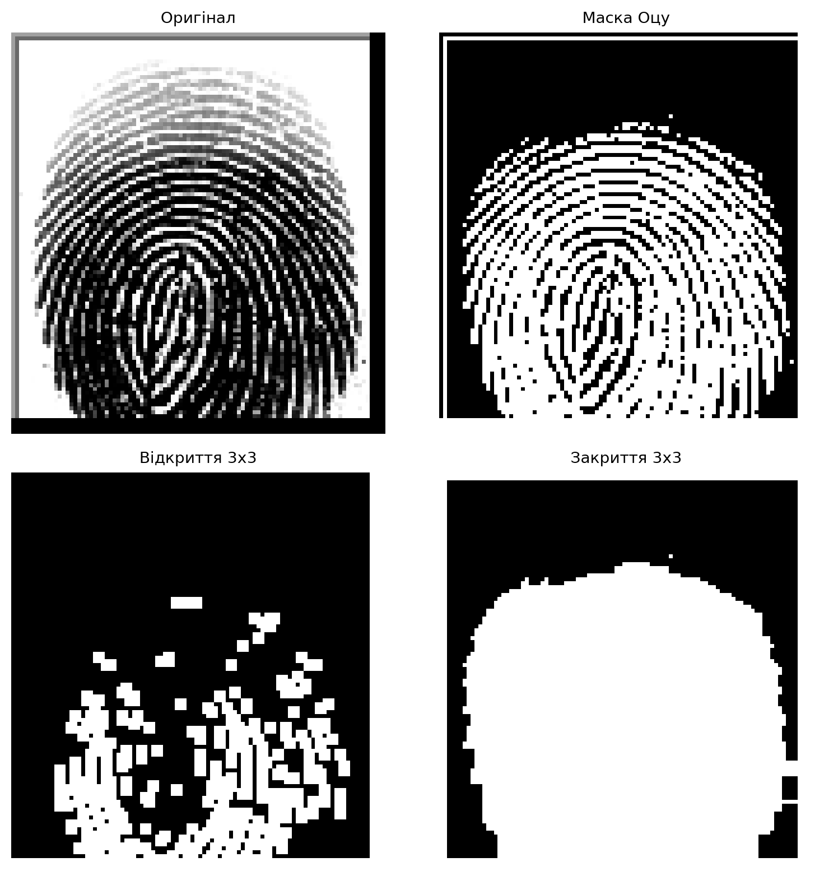
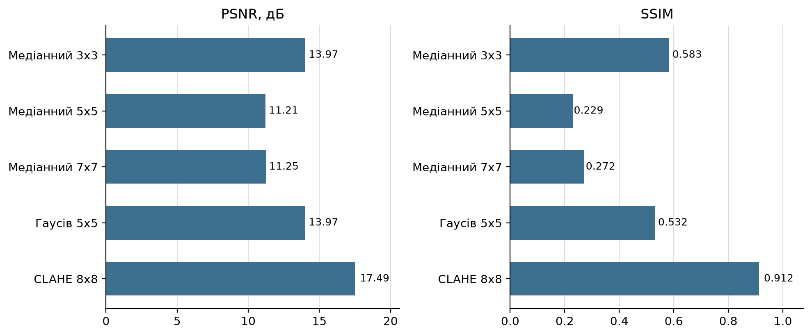
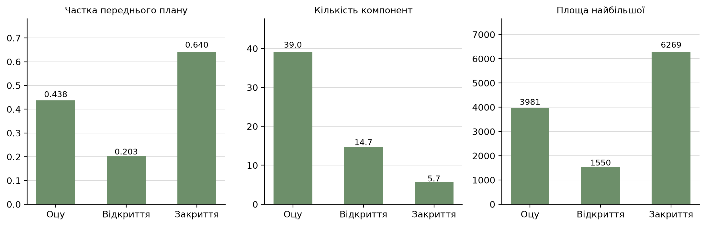
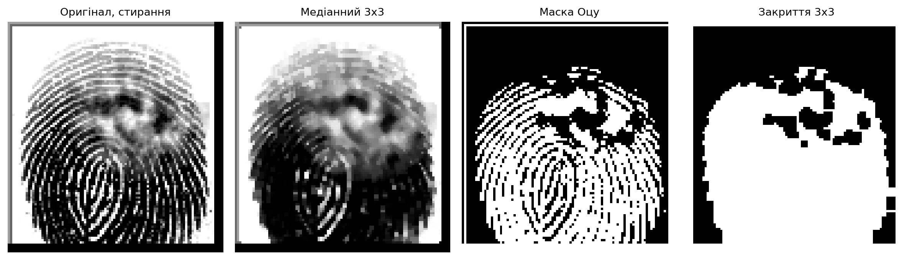

## АНОТАЦІЯ

Розроблено програму для обробки та аналізу зображень відбитків пальців
класичними методами комп'ютерної графіки. Реалізовано шість методів:
медіанний фільтр, гаусів фільтр, CLAHE, метод Оцу, морфологічні відкриття
та закриття, а також матрицю суміжності рівнів сірого GLCM. Усі алгоритми
написано вручну засобами NumPy; OpenCV і Pillow використовуються лише для
читання та збереження зображень.

Експеримент проведено на вибірці з 200 знімків SOCOFing: 120 реальних
і 80 змінених. Для методів підсилення обчислено MSE, PSNR і SSIM відносно
оригіналу, для бінарних масок - частку переднього плану, кількість
зв'язаних компонент і площу найбільшої компоненти, для текстур - контраст,
енергію, гомогенність і кореляцію GLCM. Найвищі показники серед фільтрів
отримав CLAHE: PSNR 17.49 дБ і SSIM 0.912. Метод Оцу дає фрагментовану
маску, а морфологічні операції по-різному змінюють її площу та зв'язність.
Отримані результати підтверджують, що класичні методи забезпечують
відтворювану обробку без навчання, але потребують вибору параметрів
під конкретну задачу.

**Ключові слова:** обробка зображень, медіанний фільтр, гаусів фільтр,
CLAHE, метод Оцу, морфологія, GLCM, PSNR, SSIM, SOCOFing.

## 1 ВСТУП

### 1.1 Актуальність

Цифрові зображення потребують попередньої обробки перед аналізом:
потрібно прибрати шум, підвищити контраст, відокремити об'єкт від фону
та описати його текстуру. Для відбитків пальців ці кроки особливо важливі,
оскільки гребені мають малий масштаб, а якість знімка залежить від способу
сканування та стану пальця.

Класичні методи комп'ютерної графіки не потребують навчальних даних,
працюють детерміновано і дозволяють пояснити кожен крок обробки. Саме тому
вони залишаються базою для порівняння з сучасними підходами на основі
нейронних мереж.

### 1.2 Мета і завдання

Мета роботи: розробити програму, яка автоматично обробляє вибірку зображень
відбитків пальців обраними методами, зберігає результати та метрики якості,
а також порівняти методи між собою.

Завдання:

1. Сформувати фіксовану вибірку зображень і описати її маніфестом.
2. Реалізувати шість методів вручну, без бібліотечних алгоритмів обробки.
3. Обчислити метрики для кожного знімка та зберегти їх у CSV.
4. Порівняти методи кількісно і якісно, визначити їхні обмеження.

### 1.3 Об'єкт і предмет дослідження

Об'єкт: цифрові зображення відбитків пальців. Предмет: вплив класичних
методів фільтрації, сегментації, морфології та аналізу текстур на якість
і структуру зображення.

### 1.4 Огляд суміжних робіт

Класичні підходи до покращення зображень описані в підручнику Gonzalez
і Woods [5]. Для видалення імпульсного шуму зазвичай застосовують медіанний
фільтр, для гаусового шуму - згортку з гаусовим ядром. Локальне вирівнювання
гістограми з обмеженням контрасту запропоновано в роботі Zuiderveld [2]
і стало стандартним засобом підсилення локальних деталей.

Поріг Оцу [1] залишається одним із найпростіших методів автоматичної
бінаризації. Морфологічні операції описані в роботі Soille [6] і
використовуються для очищення масок. Текстурні ознаки на основі матриці
суміжності рівнів сірого введені Haralick та співавторами [3].

Для оцінювання якості використано PSNR і SSIM. SSIM запропонований Wang
та співавторами [4] як метрика, що враховує локальну структуру, а не лише
попиксельну різницю.

Сучасні роботи з покращення відбитків пальців усе частіше використовують
нейронні мережі та генеративні моделі. Вони дають вищу якість на складних
знімках, але потребують навчальних даних, значних обчислювальних ресурсів
і гірше піддаються поясненню. У цій роботі свідомо обрано класичний підхід,
оскільки мета полягає в порівнянні простих і прозорих алгоритмів.

## 2 ОПИС ВИБІРКИ ЗОБРАЖЕНЬ

Джерело даних: SOCOFing (Sokoto Coventry Fingerprint Dataset) [7]. Датасет
завантажується вручну і розпаковується в `data/raw/`. У репозиторії
зберігається лише маніфест `data/manifest.tsv`.

| Параметр | Значення |
|---|---|
| Основна вибірка | 120 реальних знімків, суб'єкти 1..12, по 10 пальців |
| Додаткова вибірка | 80 змінених знімків Altered-Hard, суб'єкти 1..8, тип `_Obl` |
| Усього | 200 знімків |
| Розмір | 96x103 пікселя |
| Формат | BMP, 8 біт на канал |
| Колірний режим | RGBA або RGB для реальних, L для змінених; усе приводиться до L |

Змінені знімки не є окремим експериментом. Вони використовуються як готові
тест-кейси для перевірки стійкості методів: на зіпсованих знімках медіанний
фільтр і морфологія повинні давати інший результат, ніж на чистих.

Маніфест містить шлях, групу, суб'єкта, руку, палець, тип зміни та sha256
кожного файлу. Вибірку можна перевірити командами:

```
uv run python scripts/build_manifest.py
uv run python scripts/check_dataset.py --manifest data/manifest.tsv
```

## 3 МЕТОДИ ТА ПРОГРАМНА РЕАЛІЗАЦІЯ

### 3.1 Медіанний фільтр

Медіанний фільтр замінює значення пікселя медіаною вікна. Він добре
прибирає імпульсний шум і зберігає межі, оскільки медіана стійка до
поодиноких викидів. Досліджено вікна 3x3, 5x5 і 7x7. Більше вікно сильніше
згладжує, але втрачає дрібні гребені.

Реалізація: `src/cgstem/methods/filtering.py`, функція `median_filter`.
Ковзне вікно будується засобами NumPy, краї доповнюються відбиттям.

### 3.2 Гаусів фільтр

Гаусів фільтр виконує згортку з нормованим гаусовим ядром. Ваги спадають
із відстанню від центра, тому сусідні пікселі впливають плавно. Використано
ядро 5x5 із sigma 1.0: воно помітно зменшує шум, але не придушує структуру
повністю.

Реалізація: `src/cgstem/methods/filtering.py` і `src/cgstem/ops/kernels.py`.
Згортка написана вручну в `src/cgstem/ops/convolution.py`.

### 3.3 CLAHE

CLAHE (contrast limited adaptive histogram equalization) ділить зображення
на блоки, будує для кожного окрему гістограму, обмежує висоту стовпців
і розподіляє надлишок. Далі таблиці перетворення сусідніх блоків змішуються
білінійно, тому на межах немає різких переходів.

Параметри: clip limit 2.0, сітка 8x8. Обмеження не дає підсилити шум
у майже однорідних областях, а сітка задає локальний масштаб.

Реалізація: `src/cgstem/methods/histogram.py`, функція `clahe`.

### 3.4 Метод Оцу

Метод Оцу перебирає всі пороги гістограми та вибирає той, для якого
міжкласова дисперсія максимальна. Отримана маска містить темні піксели,
тобто гребені відбитка.

Реалізація: `src/cgstem/methods/segmentation.py`, функції `otsu_threshold`
і `otsu_mask`.

### 3.5 Морфологічні відкриття та закриття

Відкриття (ерозія, потім дилатація) прибирає дрібні об'єкти. Закриття
(дилатація, потім ерозія) заповнює дрібні отвори. Використано структурний
елемент 3x3. Обидві операції застосовуються до маски Оцу.

Реалізація: `src/cgstem/methods/morphology.py`.

### 3.6 GLCM

Матриця суміжності рівнів сірого описує, як часто пари пікселів із
певними значеннями зустрічаються на заданій відстані та в заданому
напрямку. Використано відстані 1..3 і кути 0, 45, 90, 135 градусів.

Обчислюються:

- контраст: середньозважена квадратична різниця рівнів;
- енергія: корінь суми квадратів імовірностей;
- гомогенність: близькість розподілу до діагоналі;
- кореляція: лінійний зв'язок рівнів сусідніх пікселів.

Реалізація: `src/cgstem/methods/texture.py`.

### 3.7 Метрики якості

Для методів підсилення обчислюються MSE, PSNR і SSIM відносно оригіналу.
Для бінарних масок PSNR і SSIM не показові, тому використовуються частка
переднього плану, кількість зв'язаних компонент за восьмизв'язністю та
площа найбільшої компоненти. Для текстур звітуються середні властивості
GLCM.

Визначення метрик наведено в `docs/metrics.md`. Реалізація:
`src/cgstem/metrics`.

### 3.8 Архітектура програми

```
cgstem/
├── io/          читання і збереження зображень
├── ops/         згортка, ядра, перевірки
├── methods/     шість методів за категоріями
├── metrics/     MSE, PSNR, SSIM, показники масок
├── pipeline/    конфігурація, стадії, збереження, запуск
└── cli/         командний рядок
```

Параметри задаються в `configs/methods.yaml`. Аргумент `--set` перекриває
окреме значення без зміни коду. Одна команда обробляє всю вибірку:

```
uv run cgstem
```

Фінальні зображення зберігаються в `out/images`, проміжні результати стадій
в `out/stages`, метрики в `out/metrics/metrics.csv`, середні значення в
`out/metrics/summary.csv`.

## 4 РЕЗУЛЬТАТИ

### 4.1 Умови експерименту

Оброблено 200 знімків, отримано 1800 рядків метрик. Для кожного знімка
запущено дев'ять варіантів: медіанний фільтр із вікнами 3, 5, 7, гаусів
фільтр, CLAHE, Оцу, відкриття, закриття та GLCM. У таблицях наведено середні
значення по вибірці.

### 4.2 Фільтрація

**Таблиця 4.1. Середні метрики фільтрів відносно оригіналу**

| Метод | MSE | PSNR, дБ | SSIM |
|---|---|---|---|
| Медіанний, вікно 3 | 2826.82 | 13.97 | 0.583 |
| Медіанний, вікно 5 | 5433.65 | 11.21 | 0.229 |
| Медіанний, вікно 7 | 5221.36 | 11.25 | 0.272 |
| Гаусів, 5x5, sigma 1.0 | 2798.67 | 13.97 | 0.532 |
| CLAHE, clip 2.0, сітка 8x8 | 1196.06 | 17.49 | 0.912 |

Абсолютні значення PSNR нижчі за типові 30 дБ не через помилку: знімки
мають високий контраст, гребені займають більшу частину площі, тому будь-який
фільтр змінює багато пікселів. Порівнювати ці числа треба між методами,
а не з літературою.

**Таблиця 4.2. Метрики фільтрів окремо для реальних і змінених знімків**

| Метод | PSNR, реальні | SSIM, реальні | PSNR, змінені | SSIM, змінені |
|---|---|---|---|---|
| Медіанний, вікно 3 | 12.98 | 0.549 | 15.45 | 0.634 |
| Медіанний, вікно 5 | 10.09 | 0.164 | 12.90 | 0.326 |
| Медіанний, вікно 7 | 10.35 | 0.231 | 12.59 | 0.333 |
| Гаусів, 5x5, sigma 1.0 | 13.01 | 0.493 | 15.40 | 0.591 |
| CLAHE, clip 2.0, сітка 8x8 | 17.89 | 0.918 | 16.90 | 0.904 |

На змінених знімках усі фільтри дають вищі PSNR і SSIM, ніж на реальних.
Причина в тому, що стирання частини гребенів зменшує локальні перепади,
і фільтр змінює меншу кількість контрастних пікселів. Це не означає кращу
обробку: метрика лише фіксує менше відхилення від уже пошкодженого оригіналу.

{width=14cm}

### 4.3 Сегментація та морфологія

**Таблиця 4.3. Показники бінарних масок**

| Метод | Частка переднього плану | Компонент | Площа найбільшої |
|---|---|---|---|
| Оцу | 0.438 | 39.0 | 3981 |
| Оцу + відкриття 3x3 | 0.203 | 14.7 | 1550 |
| Оцу + закриття 3x3 | 0.640 | 5.7 | 6269 |

Маска Оцу містить окремі гребені, тому кількість компонент велика. Відкриття
прибирає тонкі структури разом із шумом, а закриття з'єднує сусідні гребені
в суцільну область.

{width=14cm}

### 4.4 Аналіз текстур

**Таблиця 4.4. Середні властивості GLCM за групами**

| Група | Контраст | Енергія | Гомогенність | Кореляція |
|---|---|---|---|---|
| Уся вибірка | 9625.85 | 0.261 | 0.374 | 0.540 |
| Реальні знімки | 11173.41 | 0.268 | 0.383 | 0.497 |
| Змінені `_Obl` | 7304.51 | 0.251 | 0.360 | 0.605 |

### 4.5 Візуальне порівняння

Діаграми на рисунках 4.3 і 4.4 узагальнюють кількісні результати. Рисунок 4.5
показує поведінку методів на зміненому знімку: медіанний фільтр згладжує
пошкоджену область, маска Оцу втрачає частину гребенів, а закриття заповнює
розриви, але розширює передній план.

{width=16cm}

{width=16cm}

{width=16cm}

### 4.6 Порівняння з суміжними підходами

Класичні методи поступаються сучасним нейромережевим рішенням за якістю
на складних знімках, але не потребують навчання, працюють швидко та
передбачувано. У цій роботі важлива саме порівнюваність методів між собою
на однаковій вибірці, а не досягнення максимальної якості відбитка.

## 5 ОБГОВОРЕННЯ

CLAHE має найвищі PSNR і SSIM серед фільтрів, оскільки локально підсилює
контраст, не змінюючи структуру гребенів так сильно, як згладжувальні
фільтри. Гаусів фільтр дає PSNR, близький до медіанного з вікном 3, але
нижчий SSIM: згладжування розмиває дрібні деталі.

Для медіанного фільтра збільшення вікна не дає монотонного погіршення
SSIM: вікно 5 має 0.229, а вікно 7 - 0.272. Це пояснюється тим, що на
дрібних зображеннях велике вікно усереднює більше сусідніх гребенів
і по-іншому змінює локальні дисперсії.

Метод Оцу дає 39 компонент, оскільки окремі гребені не з'єднані між собою.
Відкриття зменшує кількість компонент до 14.7, але втрачає понад половину
площі переднього плану. Закриття, навпаки, зменшує кількість компонент
до 5.7, проте переповнює маску до 64.0 відсотка площі. Отже, вибір операції
залежить від задачі: відкриття прибирає шум, закриття заповнює розриви.

GLCM показує, що змінені знімки `_Obl` мають нижчий контраст і вищу
кореляцію, ніж реальні. Це узгоджується зі стиранням частини гребенів:
текстура стає одноріднішою, а сусідні пікселі - більш схожими.

Обмеження роботи:

- метрики PSNR, MSE і SSIM вимірюють відхилення від оригіналу, а не
  покращення якості;
- для масок немає еталонної сегментації, тому показники описують структуру
  маски, а не її правильність;
- параметри методів фіксовані для всієї вибірки і не адаптуються до
  конкретного знімка;
- зображення малі (96x103), тому результати не можна прямо переносити на
  знімки високої роздільності.

## 6 ВИСНОВКИ

1. Реалізовано шість класичних методів обробки зображень уручну, без
   бібліотечних алгоритмів комп'ютерного зору.
2. Створено пайплайн, який однією командою обробляє всю вибірку, зберігає
   фінальні зображення, проміжні результати стадій і метрики у CSV.
3. Повторний запуск із тими самими параметрами дає ідентичні результати.
4. CLAHE показав найкращі показники серед методів підсилення: PSNR 17.49 дБ
   і SSIM 0.912.
5. Морфологічні операції по-різному впливають на маску: відкриття зменшує
   площу та кількість компонент, закриття заповнює розриви, але переповнює
   маску.
6. GLCM підтвердив різницю між реальними та зміненими знімками за
   контрастом і кореляцією.

Напрямки подальшої роботи: еталонна сегментація для оцінювання масок,
автоматичний підбір параметрів, адаптивні локальні пороги, порівняння
з нейромережевими методами на тій самій вибірці.

## СПИСОК ДЖЕРЕЛ

1. Otsu N. A threshold selection method from gray-level histograms.
   IEEE Transactions on Systems, Man, and Cybernetics. 1979. Vol. 9, No. 1.
   P. 62-66.
2. Zuiderveld K. Contrast limited adaptive histogram equalization.
   Graphics Gems IV. San Diego: Academic Press, 1994. P. 474-485.
3. Haralick R. M., Shanmugam K., Dinstein I. Textural features for image
   classification. IEEE Transactions on Systems, Man, and Cybernetics. 1973.
   Vol. 3, No. 6. P. 610-621.
4. Wang Z., Bovik A. C., Sheikh H. R., Simoncelli E. P. Image quality
   assessment: from error visibility to structural similarity. IEEE
   Transactions on Image Processing. 2004. Vol. 13, No. 4. P. 600-612.
5. Gonzalez R. C., Woods R. E. Digital Image Processing. 4th ed.
   New York: Pearson, 2018. 1168 p.
6. Soille P. Morphological Image Analysis: Principles and Applications.
   2nd ed. Berlin: Springer, 2004. 391 p.
7. Shehu Y. I., Ruiz-Garcia A., Palade V., James A. Sokoto Coventry
   Fingerprint Dataset (SOCOFing). arXiv:1807.10609, 2018.

## ДОДАТОК А. ЛІСТИНГ КЛЮЧОВИХ ФУНКЦІЙ

Повний код програми: каталог `src/cgstem`. Нижче наведено функції, які
безпосередньо реалізують методи обробки.

### А.1 Фільтрація

```python
def median_filter(image: GrayImage, size: int = 3) -> GrayImage:
    """Прибирає імпульсний шум медіаною у вікні заданого розміру."""
    check_window(size)
    pad = size // 2
    padded = np.pad(image, pad, mode="reflect")
    windows = sliding_window_view(padded, (size, size))
    return np.median(windows, axis=(-2, -1)).astype(np.uint8)


def gaussian_blur(image: GrayImage, size: int = 5,
                  sigma: float = 1.0) -> GrayImage:
    """Згладжує зображення гаусовим ядром."""
    check_window(size)
    if sigma <= 0:
        raise ValueError(f"Сигма повинна бути додатною, отримано {sigma}")
    kernel = gaussian_kernel(size, sigma)
    smoothed = convolve2d(image.astype(np.float64), kernel)
    return to_uint8(smoothed)
```

### А.2 CLAHE

```python
def clahe(image: GrayImage, clip_limit: float = 2.0,
          grid: tuple[int, int] = (8, 8)) -> GrayImage:
    """Вирівнює гістограму локально з обмеженням і білінійним змішуванням."""
    check_params(image, clip_limit, grid)
    rows, cols = actual_grid(image.shape, grid)
    luts, row_edges, col_edges = build_luts(image, rows, cols, clip_limit)
    result = interpolate(image, luts, row_edges, col_edges)
    return np.clip(np.rint(result), 0, HIST_SIZE - 1).astype(np.uint8)


def clip_histogram(hist: FloatImage, clip_limit: float) -> FloatImage:
    """Обмежує висоту стовпців і розподіляє надлишок по решті кошиків."""
    tile_size = hist.sum()
    threshold = max(int(clip_limit * tile_size / HIST_SIZE), 1)
    clipped = np.minimum(hist, threshold)
    excess = int(hist.sum() - clipped.sum())
    clipped += excess // HIST_SIZE
    clipped[:excess % HIST_SIZE] += 1
    return clipped
```

### А.3 Сегментація

```python
def otsu_threshold(image: GrayImage) -> int:
    """Обчислює поріг Оцу, що максимізує міжкласову дисперсію."""
    check_image(image)
    hist = np.bincount(image.ravel(), minlength=HIST_SIZE).astype(np.float64)
    levels = np.arange(HIST_SIZE, dtype=np.float64)
    total = hist.sum()
    weight_back = np.cumsum(hist)
    weight_front = total - weight_back
    sum_back = np.cumsum(hist * levels)
    sum_front = sum_back[-1] - sum_back
    valid = (weight_back > 0) & (weight_front > 0)
    mean_back = np.divide(sum_back, weight_back, out=np.zeros_like(sum_back), where=valid)
    mean_front = np.divide(sum_front, weight_front, out=np.zeros_like(sum_front), where=valid)
    variance = weight_back * weight_front * (mean_back - mean_front) ** 2
    variance = np.where(valid, variance, 0.0)
    return int(np.argmax(variance))
```

### А.4 Морфологія

```python
def erode(mask: Mask, size: int = 3) -> Mask:
    """Звужує маску: піксель лишається, коли все вікно належить масці."""
    check_window(size)
    windows = mask_windows(mask, size)
    return np.all(windows, axis=(-2, -1))


def dilate(mask: Mask, size: int = 3) -> Mask:
    """Розширює маску: піксель додається, коли вікно зачіпає маску."""
    check_window(size)
    windows = mask_windows(mask, size)
    return np.any(windows, axis=(-2, -1))


def opening(mask: Mask, size: int = 3) -> Mask:
    """Прибирає дрібні об'єкти: ерозія, потім дилатація."""
    return dilate(erode(mask, size), size)


def closing(mask: Mask, size: int = 3) -> Mask:
    """Заповнює дрібні отвори: дилатація, потім ерозія."""
    return erode(dilate(mask, size), size)
```

### А.5 GLCM

```python
def glcm_matrix(image: GrayImage, distance: int = 1,
                angle: int = 0) -> FloatImage:
    """Повертає нормовану матрицю суміжності для заданих відстані та кута."""
    check_image(image)
    if distance < 1:
        raise ValueError(f"Відстань повинна бути додатною, отримано {distance}")
    offset = angle_offset(angle, distance)
    source, target = offset_slices(image, offset)
    if source.size == 0:
        raise ValueError(f"Відстань {distance} перевищує розміри зображення")
    indices = source.astype(np.intp) * HIST_SIZE + target
    counts = np.bincount(indices.ravel(), minlength=HIST_SIZE ** 2)
    return counts.reshape(HIST_SIZE, HIST_SIZE) / counts.sum()
```

### А.6 Оркестрація пайплайна

```python
def process_image(image: GrayImage, config: dict) -> list[MethodResult]:
    """Виконує всі вибрані стадії для одного знімка."""
    results = filtering_results(image, config)
    if "otsu" in config or "morphology" in config:
        mask = otsu_mask(image)
        if "otsu" in config:
            results.append(segmentation_result(mask))
        if "morphology" in config:
            results.extend(morphology_results(mask, config))
    results.extend(texture_results(image, config))
    return results
```

## ДОДАТОК Б. ІНСТРУКЦІЯ КОРИСТУВАЧА

1. Встановити Python 3.10 або новіше і менеджер `uv`.
2. Виконати `uv sync`.
3. Завантажити SOCOFing у `data/raw/`.
4. Перевірити вибірку:
   `uv run python scripts/check_dataset.py --manifest data/manifest.tsv`.
5. Запустити обробку всієї вибірки: `uv run cgstem`.
6. Переглянути результати в `out/images`, `out/stages`, `out/metrics`.

Для вибору окремих методів або зміни параметрів:

```
uv run cgstem --methods median,clahe
uv run cgstem --set median.sizes=[3,7]
```
